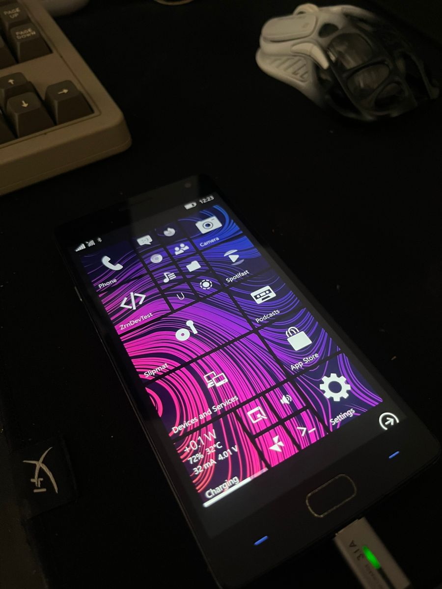
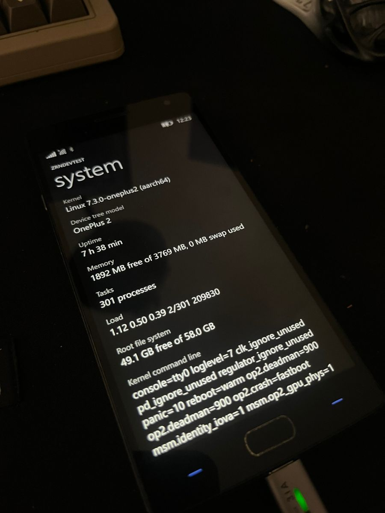
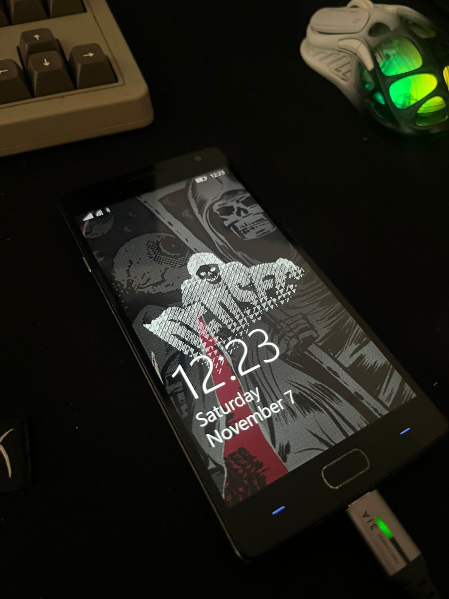

# OnePlus 2 su Linux mainline (per ztOS)

[English](README.md)

Porting del **OnePlus 2** (ONE A2003, Qualcomm MSM8994 / Snapdragon 810) su Linux
mainline, per usare [ztOS](https://github.com/luvingiane/ztOS) (Arch Linux ARM +
ztMETRO) come dispositivo di casa. Patch del kernel, device tree, strumenti per le
immagini di avvio, piccoli programmi per il telefono e il diario completo del lavoro.

> Sperimentale. Tutto è stato provato su due telefoni dello stesso modello. Le
> immagini si avviano di solito dalla RAM (`fastboot boot`): sul telefono non viene
> scritto niente finché non lo flashi tu. Prima fai il backup delle partizioni (vedi
> [docs/BACKUP.md](docs/BACKUP.md)) e non toccare mai le partizioni modem/EFS.

## Stato (in breve)

Ultima tappa (2026-11-03): la GPU hardware disegna l'interfaccia di ztOS su mainline 7.3, vedi
[docs/MILESTONE-2026-11-03.md](docs/MILESTONE-2026-11-03.md) (in inglese).

**19 funzionano · 3 parziali · 9 non funzionano · 7 non provati**

*Funziona* vuol dire il 100% della funzione, provata sul telefono; *Parziale* dice nelle note cosa manca. Stesse parole delle pagine dispositivo di ztOS ([devices.ztos.online](https://devices.ztos.online)).

**20 funzionano · 2 parziali · 10 non funzionano · 6 non provati**

*Funziona* vuol dire il 100% della funzione, provata sul telefono; *Parziale* dice nelle note cosa manca. Stesse parole delle pagine dispositivo di ztOS ([devices.ztos.online](https://devices.ztos.online)).

**21 funzionano · 2 parziali · 9 non funzionano · 6 non provati**

*Funziona* vuol dire il 100% della funzione, provata sul telefono; *Parziale* dice nelle note cosa manca. Stesse parole delle pagine dispositivo di ztOS ([devices.ztos.online](https://devices.ztos.online)).

**23 funzionano · 3 parziali · 8 non funzionano · 4 non provati**

*Funziona* vuol dire il 100% della funzione, provata sul telefono; *Parziale* dice nelle note cosa manca. Stesse parole delle pagine dispositivo di ztOS ([devices.ztos.online](https://devices.ztos.online)).

| Categoria | Funzione | Stato | Note |
|---|---|---|---|
| Boot | Mainline kernel boot (7.3), from RAM and from flash | 🟢 Funziona | `fastboot boot` e partizione boot; l'avvio a freddo arriva alla shell ztMETRO |
| Boot | Boot logo | 🟢 Funziona | logo Arch Linux nella partizione `LOGO` (`tools/boot-logo`) |
| Boot | CPU, 4 × A53 | 🟢 Funziona | avvio ACC stile CAF (patch 0010), clock fisso di circa 1,5 GHz |
| Boot | CPU, 4 × A57 | 🟡 Parziale | accesi e stabili a pieno carico a 600 MHz fissi (8 core, con display e GPU attivi); un clock più alto tramite la PLL del cluster blocca il boot insieme alla GPU (causa in ricerca); spenti di default perché 8 core scaldano molto |
| Boot | CPU frequency scaling | 🔴 Non funziona | niente cpufreq: driver del clock e tabella OPP sono bozze, una prova a 1 V / 1536 MHz ha fatto crashare l'avvio |
| Display | Panel (JD35695, 1080p, DSI command mode) | 🟢 Funziona | driver del pannello (`kernel/panel`), MDP5 + DSI |
| Display | GPU (Adreno 430) | 🟢 Funziona | OpenGL ES 3.0 hardware (freedreno) disegna tutta l'interfaccia; servono le patch 0130 + 0144 (IOVA identità, il TZ rifiuta la SMMU) |
| Input | Touchscreen (Synaptics S3320) | 🟢 Funziona | multi-touch; il GPIO 74 deve restare acceso |
| Input | Power and volume keys | 🟢 Funziona | screenshot con accensione + volume su, volume a schermo spento |
| Input | Capacitive touch keys | 🟢 Funziona | i tasti indietro e recenti (cerca) funzionano; il tasto home è il pad dell'impronta, letto via SPI dal demone op2-fpcd (KEY_HOMEPAGE tramite uinput) |
| Input | Alert slider | 🟢 Funziona | `gpio-keys` F13/F15 |
| Audio | Loudspeaker | 🟢 Funziona | ADSP + MI2S quaternario q6 → TFA9890 |
| Audio | Earpiece, headphone jack, microphones | 🔴 Non funziona | codec WCD9330: lo SLIMbus non enumera mai (capability exchange scade), nessun driver mainline del codec |
| Audio | Audio of a phone call | 🔴 Non funziona | serve il percorso modem-codec su SLIMbus |
| Audio | Ringtone | 🟢 Funziona | il telefono suona alla chiamata in arrivo (mancava il file della suoneria; risolto, confermato con una chiamata vera) |
| Modem | Modem start and SIM | 🟢 Funziona | remoteproc MSS + ADSP, `rmtfs`, il DPM QMI apre `DATA5_CNTL`, sessione USIM (`scripts/op2-modem-up.sh`) |
| Modem | Mobile network (LTE) and operator name | 🟢 Funziona | si registra in LTE; tacche e operatore in ztOS |
| Modem | SMS | 🟢 Funziona | lette dalla memoria della SIM |
| Modem | Phone calls | 🟡 Parziale | squillo, risposta e chiusura funzionano (serve un client QMI VOICE perché la rete avvisi il telefono); ancora niente audio della voce |
| Modem | Mobile data | 🔴 Non funziona | manca il percorso dei pacchetti: l'IPA v2 dell'MSM8994 non ha un driver mainline |
| Modem | Airplane mode | 🟢 Funziona | ferma il modem (`AT+CFUN=4` ne fa crashare il firmware): `scripts/op2-airplane.sh` |
| Modem | Second SIM | ⚪ Non provato |  |
| Network | Wi-Fi (QCA6174 on PCIe1) | 🟢 Funziona | ath10k scansiona e si associa (patch 0149-0165) |
| Network | Bluetooth | 🟢 Funziona | controller via UART, audio via Bluetooth provato e funzionante; l'indirizzo BD di fabbrica non è valido e va impostato |
| Network | USB networking (device mode) | 🟢 Funziona | NCM + ssh; un watchdog può rimandare il telefono in fastboot se la USB non sale |
| Network | USB host (OTG) | ⚪ Non provato |  |
| Location | GPS | 🔴 Non funziona | non iniziato (sta nel modem: QMI LOC) |
| Camera | Front camera (OV5648) | 🔴 Non funziona | CSIPHY/CSID/ISPIF/VFE allineati al driver originale, il test pattern del CSID passa, ma nessun pacchetto MIPI dal sensore (PHY status 0) |
| Camera | Rear camera (OV13860) | 🔴 Non funziona | bozza di driver in `kernel/patches-73` (0189, 0190), mai eseguita |
| Sensors | Ambient light | 🟢 Funziona | gestore sensori dell'ADSP con `tools/op2-sensord` |
| Sensors | Proximity | 🔴 Non funziona | dà un valore costante anche se coperto (non ancora capito) |
| Sensors | Accelerometer, gyroscope, magnetometer | ⚪ Non provato | l'ADSP li invia (`op2-sensord watch`), non controllati; niente rotazione automatica |
| Sensors | Hall sensor | ⚪ Non provato | `SW_MACHINE_COVER` sul GPIO 75 |
| Sensors | Fingerprint reader | 🟡 Parziale | l'FPC1150 risponde da Linux via SPI (REE): rilevamento del dito e cattura dell'immagine (80x208) funzionano; il riconoscimento non è ancora fatto |
| Power | Battery and charging | 🟢 Funziona | si carica fino in fondo (tensione massima 4,32 V e fine carica 150 mA come il firmware originale; il bootloader lascia 4,2 V / 250 mA e la carica si fermava all'85%); il tipo di caricatore viene letto a ogni collegamento |
| Power | Temperature and thermal throttling | 🟢 Funziona | 16 zone TSENS dai fusibili; `op2-thermal.py` rallenta i post-divisori dei PLL |
| Power | Vibration | 🟢 Funziona | motore ERM tramite il driver haptic del PMI8994; intensità tarata nella shell (durata e livello degli impulsi) |
| Power | Notification LED | 🟢 Funziona | PMI8994 LPG, rosso/verde/blu |

Stato completo per componente: [STATUS.md](STATUS.md). Il lavoro giorno per giorno,
con comandi, dump dei registri e risultati: [LOG.md](LOG.md) (in inglese).

## Sul telefono

ztMETRO su un OnePlus 2 con Linux mainline 7.3 (foto del telefono vero, 7 novembre 2026): la schermata Start, la pagina di sistema di ZrnDevTest (kernel, memoria, filesystem radice, riga di comando) e la schermata di blocco.

| Start | Sistema | Blocco |
|---|---|---|
|  |  |  |

## Struttura

| Percorso | Cosa |
|----------|------|
| `kernel/patches/` | patch per Linux 7.3 (quasi tutte valgono anche per 6.12), applicate in ordine |
| `kernel/patches-73/` | patch solo per 7.3 (GPU su indirizzi fisici, camss, lavoro su PCIe/DSI); si passano con `EXTRA_PATCHES=$PWD/kernel/patches-73` |
| `kernel/patches-612/` | patch solo per 6.12 (GPU con carveout VRAM, tracce di debug) |
| `kernel/dts/` | `msm8994-oneplus-oneplus2.dts` e `op2-*.dtsi`, attivati con `DTS_DEFINES` (`OP2_DISPLAY`, `OP2_SMP`, `OP2_USBPHY`, `OP2_WIFI`, `OP2_GPU`, ...) |
| `kernel/panel/` | il driver del pannello |
| `kernel/oneplus2*.config` | frammenti di config sopra la config msm8994 di postmarketOS |
| `scripts/` | `build-kernel.sh`, `build-boot.sh` (immagine per `fastboot boot`), backup e test |
| `initramfs/` | l'`init` dell'initramfs (gadget USB, rete, passaggio al root) |
| `rootfs-overlay/` | file aggiunti al file system di ztOS (servizio di controllo USB, regola sudoers per il menu di spegnimento) |
| `tools/` | piccoli strumenti C/Python usati sul telefono (lettura registri, comandi al pannello, test GPU) |
| `docs/` | strategia, hardware, backup |

## Compilazione

Servono una toolchain aarch64 (`build/toolchain/`, ARM GNU 14.2), i sorgenti del
kernel in `build/linux-7.3` (o 6.12 con `KSRC=`) e la config
`linux-postmarketos-qcom-msm8994` di postmarketOS in `research/pmaports/` (vedi gli script).

```bash
DTS_DEFINES="OP2_DISPLAY OP2_SMP OP2_USBPHY" bash scripts/build-kernel.sh
bash scripts/build-boot.sh mia-immagine --cmdline "op2.root=/dev/mmcblk1p43"
fastboot boot out/mia-immagine.img     # solo RAM
```

Con la GPU hardware (7.3):

```bash
EXTRA_PATCHES=$PWD/kernel/patches-73 \
DTS_DEFINES="OP2_DISPLAY OP2_SMP OP2_USBPHY OP2_GPU OP2_GPU_RPMCLK" bash scripts/build-kernel.sh
bash scripts/build-boot.sh gpu --cmdline "msm.identity_iova=1 msm.op2_gpu_phys=1 arm64.late_cpu_conflicts=warn op2.gpuhw=1 cma=768M op2.root=/dev/mmcblk1p43"
```

Se l'albero del kernel è stato compilato su un'altra macchina, controlla che `scripts/dtc/dtc` e `scripts/mod/modpost`
siano eseguibili: altrimenti `make` fallisce e i DTB restano vecchi (`build-kernel.sh` ora si ferma se `make` fallisce).

Gli script che parlano con un telefono vogliono `OP2_SERIAL` impostato. Un secondo
telefono sullo stesso computer si avvia con `op2.net=44` nella cmdline (`initramfs/init`) e si riconosce dal seriale in
`rootfs-overlay/usr/local/bin/op2-usb-watch` (`SECOND_PHONE_SERIAL`): metti lì il tuo.

## Avviare qualcosa che non sia ztOS

Kernel, device tree e initramfs non dipendono da ztOS: `scripts/build-boot.sh` produce un'immagine di avvio il cui
initramfs monta la radice indicata in `op2.root=` (una partizione ext4 della eMMC) e avvia l'init di quel sistema.
Dovrebbe andar bene qualunque filesystem radice aarch64 con systemd e un userland recente; i pezzi specifici del
telefono (servizi del modem, sensori, helper dell'aereo, controllo USB) sono file semplici in `rootfs-overlay/` e si
possono togliere o tenere. Non ancora provato con un altro sistema: è l'obiettivo quando l'elenco dell'hardware sarà
completo. Prima si avvia sempre dalla RAM (`fastboot boot`), si scrive in flash solo dopo che funziona.

## Correzioni per mainline trovate strada facendo

Alcune patch correggono bug di mainline non specifici del OnePlus 2, per esempio
`0024` (gcc-msm8994: `usb3_phy_aux_clk_src` senza parent map, puntatore nullo con
`clk_set_rate`), `0025` (ocmem: passo dei registri PSGSC di 1 byte invece di 4) e
`patches-612/0102` (a4xx cerca OCMEM sul dispositivo DRM invece che sul nodo GPU).

## Licenza

Patch del kernel, device tree e driver del pannello: GPL-2.0-only, come il kernel Linux.
Script e strumenti: GPL-2.0-only salvo diversa indicazione nel file.
